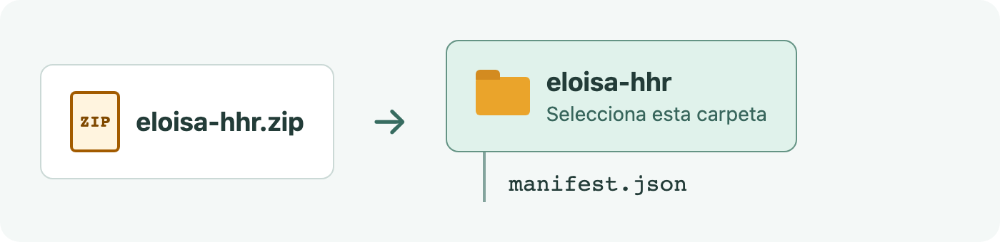
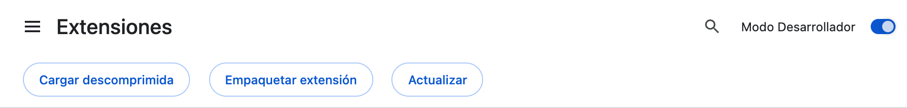

# Instalar el puente Eloísa → HHR en Chrome

1. [Descarga la extensión (.zip) desde GitHub](https://github.com/DanielOpazoD/extensioneloisahhr/releases/latest/download/eloisa-hhr.zip).
2. **Extrae el ZIP.** En Windows, haz clic derecho y elige **Extraer todo**. En macOS, haz doble clic. Deja la carpeta extraída en un lugar donde vayas a conservarla.

   

3. **Abre Extensiones de Chrome.** Escribe `chrome://extensions` en la barra de direcciones y pulsa **Enter**.
4. Activa **Modo Desarrollador** en la esquina superior derecha.
5. Pulsa **Cargar descomprimida**, arriba a la izquierda.

   

6. **Selecciona la carpeta extraída** que contiene directamente el archivo `manifest.json` y confirma la selección. Abre el menú **Extensiones** (pieza de rompecabezas) de la barra de Chrome y fija **Rayen → HHR** con la chincheta para ver el icono naranjo.

## Actualizar una instalación existente

Pulsa el icono naranjo y selecciona **Descargar actualización**. Extrae el ZIP nuevo y reemplaza el contenido de la carpeta que cargaste originalmente, conservando su nombre y ubicación. En `chrome://extensions`, pulsa **Recargar** (flecha circular) en la tarjeta de **Rayen → HHR**. Abre el icono para confirmar la versión. Guarda el trabajo que tengas abierto en Eloísa antes de recargar sus pestañas.

## Deshabilitar o volver a habilitar

Desde el icono naranjo, elige **Deshabilitar en Chrome**. Se abrirá la ficha del puente. Apaga el interruptor de la extensión. Para volver a habilitarla, entra en `chrome://extensions` y enciende el interruptor de **Rayen → HHR**.
